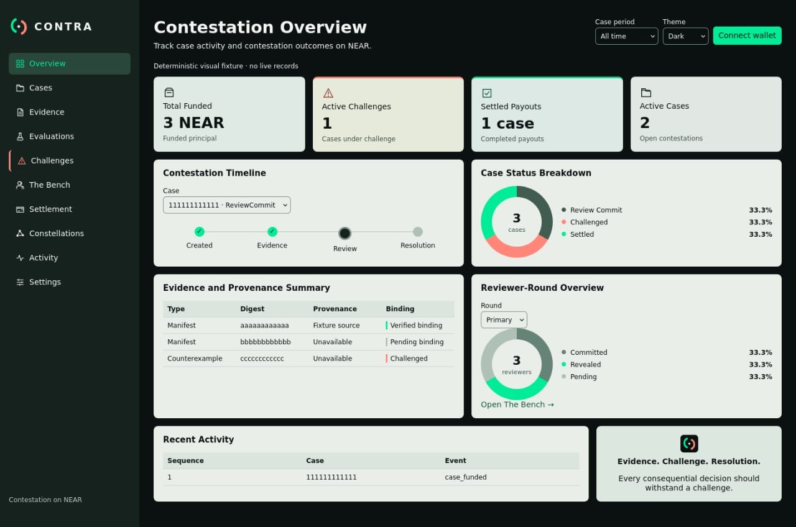
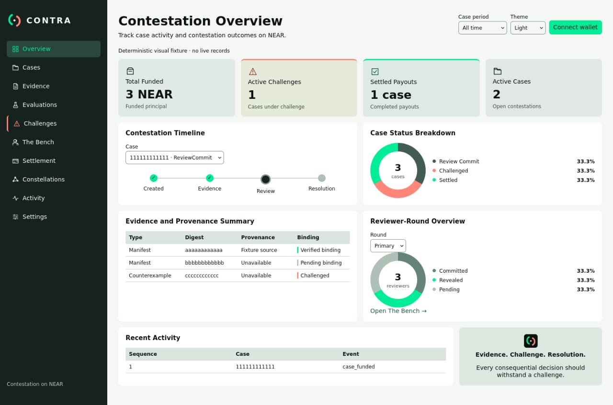
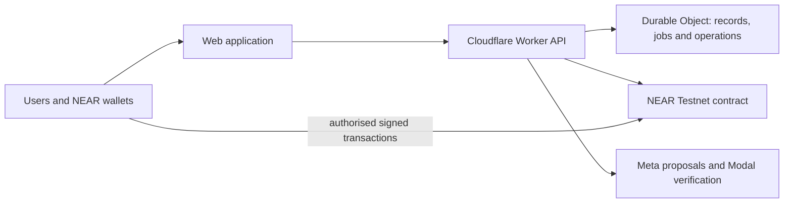

# CONTRA

**Evidence-based contestation with enforceable outcomes on NEAR.**

[](https://github.com/kellyxy110/CONTRA/actions/workflows/core.yml)
[](https://github.com/kellyxy110/CONTRA/actions/workflows/security.yml)
[](https://github.com/kellyxy110/CONTRA/actions/workflows/integration.yml)
[](LICENSE)

[Explore the public application](https://contra-near.pages.dev/) · [How it works](#how-contestation-works) · [Run locally](#run-locally) · [Technical documentation](docs/README.md) · [Completion roadmap](docs/COMPLETION_PLAN.md)

CONTRA is a NEAR-native protocol for challenging consequential decisions with attributable evidence, human review and deterministic settlement. A creator and beneficiary agree immutable conditions, evidence is bound to a case, reviewers commit and reveal their findings, and a timely challenge activates a separate appeal committee. The smart contract, rather than a model or application server, controls final outcomes and funds.

> **Current release status (13 November 2026):** The NEAR Testnet contract and secured backend are deployed. Frontend PRs #95 and #100 have been merged, but visual acceptance has been reopened after owner review. The production UI has not passed comparison against the final approved screenshots. No complete funded Testnet contestation or finalised settlement receipt is claimed; signing and case-bound provider execution remain gated.

## Final approved desktop interface

The [dark Overview](design/approved/overview-dark.jpeg) and [light Overview](design/approved/overview-light.jpeg) are the sole approved visual references. See [design authority and original image checksums](design/approved/README.md). Historical graph-first or older dashboard designs must not guide new implementation.

| Dark, default | Light |
| --- | --- |
|  |  |

Rendered visual acceptance is open until the actual product matches these two designs.

## Why CONTRA

A decision that affects money or rights needs a transparent path to challenge the evidence, evaluate disagreements and recover from execution failures.

CONTRA provides:

- **Frozen terms and native NEAR escrow:** Criteria, deadlines and committee membership are contract-bound.
- **Content-addressed evidence:** Immutable digests and provenance link off-chain records to the case without putting sensitive documents on-chain.
- **Independent human review:** Reviewers provide evidence-bound findings and submit commit-reveal votes. The primary and appeal committees must be distinct.
- **Contestable outcomes:** A valid challenge prevents ordinary settlement until the fresh review is resolved.
- **Deterministic settlement:** The contract decides payout eligibility; asynchronous failures and uncertain operations follow explicit recovery rules.
- **Bounded AI assistance:** Meta provides non-binding proposals and Modal verifies case-bound outputs. Model responses never vote, change terms or authorise transfers.

## How contestation works

1. **Create and fund.** An eligible creator proposes a case, the beneficiary consents, and native NEAR is escrowed under frozen terms.
2. **Submit evidence.** Evidence manifests and their digests are attached to the case with identifiable provenance.
3. **Evaluate and review.** Optional AI findings remain advisory. The appointed primary reviewers commit and reveal their human decisions.
4. **Challenge if necessary.** An eligible challenge introduces counterevidence and transfers review to the separate appeal committee.
5. **Resolve and settle.** The contract applies the agreed quorum and timeout rules, creates one payout intent and verifies finality through the NEAR callback.

For the authoritative rules, see [the protocol specification](docs/PROTOCOL.md), [state machine](docs/STATE_MACHINE_V1.md) and [contract ABI](docs/CONTRACT_ABI_V1.md).

## Architecture



| Layer | Responsibility | Trust boundary |
| --- | --- | --- |
| NEAR contract | Case state, immutable terms, committees, challenge, quorum and payout | Sole resolution and financial authority |
| Wallet and browser | NEP-413 account identity, authorised operations and transaction review | No signing without the actual account and exact operation authority |
| Cloudflare Worker and durable store | Protected evidence, reviewer lifecycle, provider jobs, idempotency and recovery | Cannot manufacture a finalised chain receipt |
| Meta and Modal | Evidence-bound proposal and verification | Non-binding outputs, independently budgeted and gated |
| Human reviewers | Signed consent, findings and commit-reveal actions | Independent account and operator control required |

See the [architecture](docs/ARCHITECTURE.md), [threat model](docs/THREAT_MODEL_V1.md) and [settlement recovery specification](docs/SETTLEMENT_RECOVERY_V1.md).

## Verified state and limitations

| Capability | Verified evidence or present boundary |
| --- | --- |
| Local contestation | Both complete NEAR Sandbox journeys and the judge quick-start pass at the backend completion checkpoint |
| Backend validation | 158 repository tests and 19 Cloudflare tests passed in the 12 November backend completion report |
| Backend CI | Core, Security and comprehensive Integration passed for [PR #96](https://github.com/kellyxy110/CONTRA/pull/96); the [PR #97](https://github.com/kellyxy110/CONTRA/pull/97) final records Integration gate passed |
| Testnet contract | Deployed at `contra-contestation.testnet`; [deployment record](docs/operations/TESTNET_DEPLOYMENT.md) |
| Public service | [contra-near.pages.dev](https://contra-near.pages.dev/) reports storage and chain ready at the backend checkpoint |
| Frontend release | PRs #95 and #100 merged; production visual acceptance remains pending actual side-by-side comparison |
| Genuine independent reviewers | No confirmed human operators registered at the reported Testnet observation; six independently controlled accounts required |
| Genuine case and settlement | No funded Testnet case or finalised settlement receipt yet |
| Production provider execution | Case-bound Meta and Modal paths implemented but live execution remains gated |
| Production signing | Exact operation-specific authority is required; broad signing remains disabled |

Fixture tests, Sandbox outcomes, Testnet receipts and production behaviour are reported separately. A green CI result does not establish live financial finality or independent reviewer governance.

## Run locally

Use a supported Node.js and Rust environment. For the full Sandbox journey, use Linux with the pinned NEAR Sandbox dependency.

```sh
git clone https://github.com/kellyxy110/CONTRA.git
cd CONTRA
npm ci --ignore-scripts --no-audit --no-fund
npm test
npm run test:cloudflare
npm run test:contract
npm run build:wallet
```

Start the local API in its safe default configuration:

```sh
cp .env.example .env
npm run dev
```

The local service exposes `/api/live` for liveness and `/api/ready` for storage and chain readiness. An unavailable dependency must fail closed rather than simulate a ready chain.

To reproduce the complete controlled contestation journeys on the supported Linux host:

```sh
npm run judge:local
```

This exercise uses local Sandbox identities and must not be mistaken for a funded public Testnet case. See [reproducibility and evidence](docs/testing/REPRODUCIBILITY.md) and [the judge guide](docs/judges/JUDGE_GUIDE.md).

## Security

- No private key, seed phrase or provider secret belongs in browser assets, commits or logs.
- The contract controls money and outcome finality. Reviewer signatures and eligibility are checked independently.
- UNKNOWN transactions are inspected and reconciled; they are never blindly rebroadcast.
- Case evidence and evaluation results are access-controlled and bound to the authorised account and case.
- AI is strictly advisory. Live inference and spending require explicit provider-specific readiness.

See the [security documentation](docs/THREAT_MODEL_V1.md), [dependency audit](docs/security/DEPENDENCY_AUDIT.md) and [runtime runbook](docs/operations/RUNTIME_SERVICE.md).

## Documentation and project status

Start with the [documentation index](docs/README.md). The [three-phase completion plan](docs/COMPLETION_PLAN.md) defines the remaining implementation, quality and real Testnet acceptance gates. Historical milestone reports and signed evidence remain available in the repository and Git history; they are not prerequisites for understanding the product.

## Licence

Licensed under [MIT](LICENSE). Built with NEAR Protocol, Rust, Cloudflare Workers and Durable Objects, and bounded provider integrations. AI-assisted engineering does not grant AI protocol authority.
