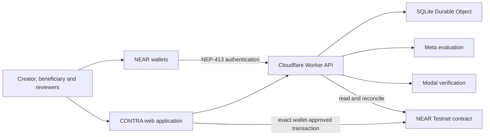

# CONTRA

**A decentralised contestation protocol for evidence-based decisions and enforceable outcomes on NEAR.**

[](https://github.com/kellyxy110/CONTRA/actions/workflows/core.yml)
[](https://github.com/kellyxy110/CONTRA/actions/workflows/security.yml)
[](https://github.com/kellyxy110/CONTRA/actions/workflows/contract.yml)
[](https://github.com/kellyxy110/CONTRA/actions/workflows/integration.yml)
[](LICENSE)

[Open CONTRA](https://contra-near.pages.dev/) · [Inspect the Testnet contract](https://testnet.nearblocks.io/address/contra-contestation.testnet) · [Judge quick-start](docs/judges/JUDGE_GUIDE.md) · [Run locally](#run-contra-locally)

CONTRA is a NEAR Hackathon project built to make consequential decisions contestable. It gives creators, beneficiaries and independent reviewers a shared protocol for freezing decision criteria, binding evidence to a case, challenging a provisional result and enforcing the final outcome through a NEAR smart contract.

**Every consequential decision should withstand a challenge.**

The public engineering release combines a NEAR Testnet contract, a Cloudflare-hosted application, NEP-413 wallet authentication, durable operation recovery, evidence provenance, human commit-reveal review, non-binding Meta evaluation and deterministic Modal verification.

## Contents

- [What CONTRA solves](#what-contra-solves)
- [How contestation works](#how-contestation-works)
- [What judges can inspect](#what-judges-can-inspect)
- [Application workspaces](#application-workspaces)
- [System architecture](#system-architecture)
- [Wallets and transaction safety](#wallets-and-transaction-safety)
- [Evidence and AI assistance](#evidence-and-ai-assistance)
- [Reviewer and committee integrity](#reviewer-and-committee-integrity)
- [Settlement and financial safety](#settlement-and-financial-safety)
- [Demo Mode and live Testnet data](#demo-mode-and-live-testnet-data)
- [Run CONTRA locally](#run-contra-locally)
- [Testing](#testing)
- [Security model](#security-model)
- [Public deployment](#public-deployment)
- [Hackathon disclosure](#hackathon-disclosure)

## What CONTRA solves

Many consequential decisions are produced by opaque services, unverifiable model outputs or processes with no safe appeal path. Even when evidence exists, the affected party may be unable to prove which evidence was considered, who reviewed it or whether settlement occurred under the agreed rules.

CONTRA provides five linked guarantees:

1. **Terms are frozen before funds move.** Criteria, participants, committee identities, deadlines and fallback rules become immutable case terms.
2. **Evidence is attributable.** Protected off-chain records are content-addressed, while their digests and bindings can be verified against the case.
3. **Review is human-controlled.** AI can propose findings, but only eligible reviewers can commit and reveal votes.
4. **Challenges block premature settlement.** A valid counterexample moves the decision to a disjoint appeal committee.
5. **The contract enforces the outcome.** NEAR controls case state, finality and the single payout intent.

## How contestation works

### 1. Create an agreement

An allowlisted creator previews the exact case, beneficiary, amount, criteria, evidence policy, committees and deadlines. The contract derives a stable case identifier and terms digest. The beneficiary must accept the same digest before funding.

### 2. Fund native NEAR escrow

The creator deposits the exact agreed amount. The contract rejects missing consent, an incorrect deposit, changed terms, duplicate funding and unauthorised callers.

### 3. Submit evidence

The beneficiary creates an immutable evidence manifest containing provenance, capture time and criterion-bound claims. The protected record remains off-chain; its digest is submitted to the contract before the evidence deadline.

### 4. Evaluate and review

Meta may produce an evidence-bound, non-binding proposal. Modal may verify the immutable proposal digest against deterministic rules. Neither provider can vote or change case state. Three eligible primary reviewers independently store findings and commit hidden votes.

### 5. Reveal the primary decision

After the commit window closes, reviewers reveal the disposition, evidence digest, finding digest and nonce. The contract checks each commitment and calculates the provisional result from authenticated reveals and frozen quorum rules.

### 6. Challenge with counterevidence

During the challenge window, an eligible participant can bind counterevidence to a contested criterion. A valid challenge blocks ordinary settlement and activates three different appeal reviewers.

### 7. Resolve and settle

The appeal committee repeats commit and reveal without overlapping the primary committee. The contract applies the final decision or agreed timeout fallback, creates one payout intent and reconciles the asynchronous NEAR transfer callback. Duplicate settlement cannot create another payout.

## What judges can inspect

### Route A: Public verification

No credentials are required to:

- open the [public application](https://contra-near.pages.dev/);
- inspect the deployed account [`contra-contestation.testnet`](https://testnet.nearblocks.io/address/contra-contestation.testnet);
- review live case states and public transaction identities;
- inspect the protocol, ABI, state machine and threat model;
- view Demo Mode without confusing simulated records with Testnet activity;
- review CI workflows and reproducible test commands.

### Route B: Local reproduction

The local judge runner builds and exercises the complete controlled contestation journey using NEAR Sandbox. It requires no paid provider account, funded wallet or production secret.

```sh
npm ci --ignore-scripts --no-audit --no-fund
npm run judge:local
```

Expected evidence includes case transitions, operation identities, receipts, challenge lockout, committee decisions, final settlement and recipient balance checks.

### Route C: Testnet exploration

Judges can connect a supported NEAR Testnet wallet, authenticate with NEP-413 and inspect account-scoped application state. Connecting a wallet does not grant transaction authority. Every mutation is prepared as an exact operation and still requires the wallet holder to approve the displayed transaction.

See the [judge guide](docs/judges/JUDGE_GUIDE.md) for the full verification matrix and expected results.

## Application workspaces

| Workspace | Purpose |
| --- | --- |
| Overview | Funding, challenge, settlement, evidence, reviewer and activity summaries |
| Cases | Search cases, inspect frozen terms, create eligible cases and recover prepared operations |
| Evidence | Create manifests, inspect provenance and submit an eligible evidence digest |
| Evaluations | Run and inspect non-binding Meta proposals and Modal verification records |
| Challenges | Check eligibility, bind counterevidence and prepare a challenge transaction |
| The Bench | Reviewer invitations, consent, disclosures, findings, commitments, reveals and recovery |
| Settlement | Inspect transaction identity, finality, receipts and locked UNKNOWN operations |
| Constellations | Compare case evidence across eight provenance and coverage dimensions |
| Activity | Read human-friendly audit events with their original technical identifiers |
| Settings | Inspect network, contract, wallet, session and theme configuration |

Dark mode is the default. Light and system preferences are supported. The interface includes responsive navigation, keyboard focus, accessible names and intentional loading, empty, unavailable and error states.

## System architecture



| Layer | Responsibility | Authority boundary |
| --- | --- | --- |
| Contestation contract | Terms, escrow, committees, rounds, challenge, finality and payout | Sole protocol and financial authority |
| Browser wallet | Account control, NEP-413 messages and user-approved transactions | No application custody of private keys |
| Cloudflare Worker | Authentication, protected APIs, chain reads and operation validation | Cannot manufacture a receipt or sign for a user |
| Durable Object | Sessions, artifacts, audit events, provider jobs and transaction recovery | Durable application record, not chain finality |
| Meta | Evidence-bound proposal | Advisory only |
| Modal | Proposal-digest verification | Advisory only |
| Human reviewers | Findings and commit-reveal votes | Must be eligible, authenticated and committee-bound |

Technical references: [architecture](docs/ARCHITECTURE.md), [protocol](docs/PROTOCOL.md), [contract ABI](docs/CONTRACT_ABI_V1.md), [state machine](docs/STATE_MACHINE_V1.md) and [settlement recovery](docs/SETTLEMENT_RECOVERY_V1.md).

## Wallets and transaction safety

CONTRA separates authentication from transaction authority.

- NEP-413 proves control of a Testnet account using a domain-bound challenge.
- Challenges expire and cannot be replayed.
- Sessions survive ordinary reloads and can be renewed or revoked.
- Account switching invalidates an incompatible session.
- Transaction intent is persisted before wallet handoff.
- The Worker reloads the operation and validates signer, contract, method, arguments, deposit and current contract state.
- The wallet holder reviews and approves the exact transaction.
- Transaction hashes are unique and durably attached to their operation.
- Finality checks require explicit success and a matching hash, signer, receiver, action, arguments, deposit and network.
- Interrupted or ambiguous operations become `UNKNOWN` and are never blindly redispatched.

The public connector advertises only wallets that provide the required Testnet and message-signing capabilities. Wallet support is capability-based rather than inferred from a wallet's Mainnet availability.

## Evidence and AI assistance

Evidence manifests record the case and frozen criterion, a content digest, provenance origin and capture time, criterion-bound claims, and access and binding state.

Meta produces structured proposals with citations, model provenance and execution metadata. Modal verifies a specific immutable proposal digest. Invalid, malformed, stale, cross-case or uncited responses fail closed.

AI artifacts cannot register reviewers, create or reveal votes, alter frozen criteria, authorise transactions, choose a binding verdict, or trigger settlement.

## Reviewer and committee integrity

A valid contested case uses six reviewer slots: three primary reviewers and three different appeal reviewers.

Reviewer onboarding records account-control authentication, operator-control disclosure, conflict disclosure, availability, explicit consent and revision identity. The contract requires active and confirmed registry entries. Committee membership is frozen into the case terms, and the two committees must be disjoint.

Local Sandbox reviewer accounts are test fixtures. They demonstrate protocol behaviour but are never described as independent human operators.

## Settlement and financial safety

CONTRA uses native Testnet NEAR and does not introduce a project token.

Financial protections include exact escrow funding, an immutable beneficiary and amount, deterministic quorum and fallback policy, challenge settlement lockout, one payout intent per resolved case, private callback-authenticated payout completion, duplicate-finalisation protection, exact recipient checks, and locked UNKNOWN payout state until a known transaction can be reconciled.

The application cannot convert a missing or ambiguous receipt into success.

## Demo Mode and live Testnet data

Demo Mode provides a populated explanation of CONTRA before a visitor connects a wallet. It is visibly labelled and completely isolated from live records. It cannot open a signing request, mutate the contract, register a reviewer, create a production operation, call a paid provider, create a receipt, or contribute to Testnet analytics.

Testnet mode displays live or honestly empty data. An unavailable backend is reported as unavailable rather than converted into zero activity.

## Run CONTRA locally

### Prerequisites

- Node.js 20 or newer
- npm
- Rust toolchain from `rust-toolchain.toml`
- Linux for the complete local NEAR Sandbox gate

### Install and verify

```sh
git clone https://github.com/kellyxy110/CONTRA.git
cd CONTRA
npm ci --ignore-scripts --no-audit --no-fund
npm test
npm run test:cloudflare
npm run test:contract
npm run build:wallet
```

### Start the safe local runtime

```sh
cp .env.example .env
npm run dev
```

The safe default does not enable live signing or paid inference. `/api/live` reports process liveness. `/api/ready` requires valid storage and a fresh Testnet chain observation.

### Run the judge journey

```sh
npm run judge:local
```

See [environment setup](docs/operations/ENVIRONMENT_SETUP.md), [reproducibility](docs/testing/REPRODUCIBILITY.md) and [Cloudflare operations](docs/operations/CLOUDFLARE_DEPLOYMENT.md).

## Testing

| Gate | Coverage |
| --- | --- |
| Core CI | Node tests, builds, documentation and source policy |
| Security CI | Secret scanning, dependency baseline and security policy |
| Contract CI | Rust format, Clippy, tests, WASM builds, ABI and commitment vectors |
| Focused Integration | Changed wallet, provider, reviewer or Sandbox pathways |
| Financial P0 | F01 through F18 escrow, payout, challenge and recovery invariants |
| Comprehensive Integration | Nine-test Sandbox baseline and both complete contestation journeys |
| Browser verification | Chromium and Firefox routes, responsive layouts, keyboard and recovery states |

The current branch verification includes 185 repository tests and 23 Cloudflare Durable Object tests. Hosted workflow badges above report the state of `main`; local results are not substituted for hosted CI.

## Security model

CONTRA assumes the web service can fail, wallets can be interrupted, providers can return malformed output, reviewers can abstain and NEAR RPC observations can be delayed.

The system fails closed: private keys and provider secrets remain wallet-held or server-side, protected evidence is account-scoped, mutation routes use rate limits and durable idempotency, provider requests use strict schemas, reviewer control statements are revision-bound, stale chain observations are rejected, production fault hooks are absent, and UNKNOWN financial operations are never automatically retried.

Review the [threat model](docs/THREAT_MODEL_V1.md), [dependency audit](docs/security/DEPENDENCY_AUDIT.md) and [release audit](docs/security/RELEASE_AUDIT.md).

## Public deployment

| Component | Public identity |
| --- | --- |
| Application | [https://contra-near.pages.dev/](https://contra-near.pages.dev/) |
| NEAR network | Testnet |
| Contract account | [`contra-contestation.testnet`](https://testnet.nearblocks.io/address/contra-contestation.testnet) |
| Contract artifact | `contra_contestation.wasm` |
| Approved production WASM SHA-256 | `49cff947a68ae2fddbc5843c22fad1d655162e50b1e81957443584ca90377a5f` |
| Current verified contract code hash | `EtUc3f99vfTwVoRJfS9MNCirxpQ5KpNFNen7XZUD7LA2` |
| Hosting | Cloudflare Workers, Pages and SQLite Durable Objects |
| Hosting cost ceiling | USD 0 on Cloudflare Free |

Deployment and upgrade transactions are recorded in the [Testnet deployment runbook](docs/operations/TESTNET_DEPLOYMENT.md). No Mainnet deployment is claimed or authorised.

## Hackathon disclosure

CONTRA is a NEAR Hackathon project. The repository preserves eligible engineering history, truthful environment boundaries and reproducible evidence. NEAR is essential because the contract freezes the agreement, authenticates reviewer actions, blocks settlement during a challenge and enforces the final payout.

The project uses AI-assisted engineering and optional AI-assisted evidence evaluation. AI has no protocol vote, signing key or settlement authority.

## Licence

Licensed under the [MIT Licence](LICENSE).
