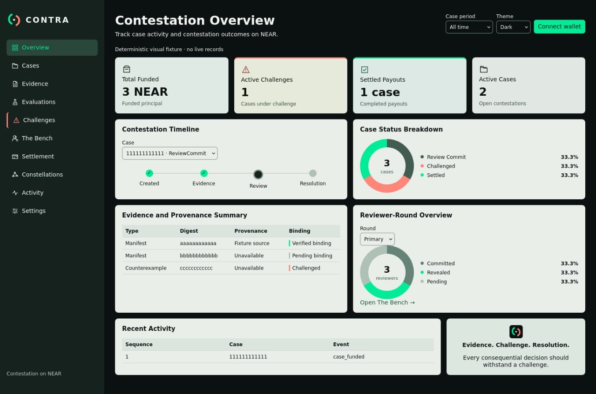
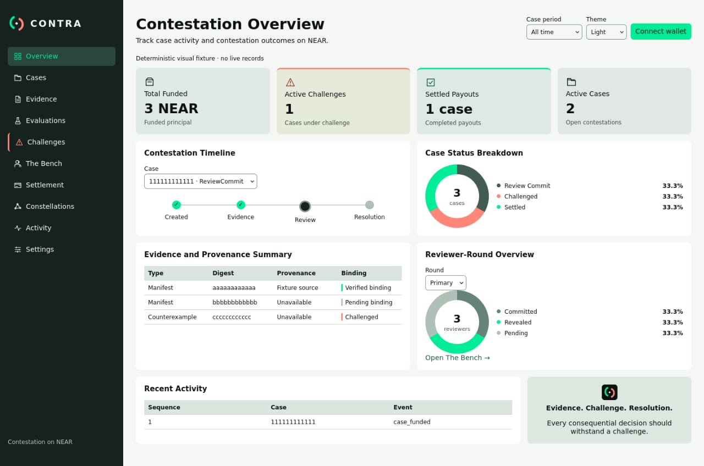

# Approved CONTRA Overview

**FINAL, owner-approved desktop design authority, 13 November 2026.**

These two JPEG screenshots are the only active desktop Overview visual references. They are stored byte-for-byte without colour edits, cropping or re-encoding. The displayed data is a deterministic visual fixture, not real Testnet evidence.

| Theme | Original image | SHA-256 | Image dimensions |
| --- | --- | --- | --- |
| Dark (default) | [overview-dark.jpeg](overview-dark.jpeg) | `3b184ab7c74fd3106d858c4b5e465c746b72136a189963de55264791e51111f4` | 1280 x 848 |
| Light | [overview-light.jpeg](overview-light.jpeg) | `e00b0fa987058aaf5ef8d6371e1eced0be02e33a0702e66aca156e9bc5002a41` | 1280 x 848 |

## Visual implementation contract

- Preserve the approved dark and light Overview with expanded left navigation, four KPI cards, two paired analytical rows, Recent Activity and the CONTRA statement.
- Keep both Overview doughnut charts in the Case Status Breakdown and Reviewer-Round Overview panels. Real zero-data states must be truthful without pretending that a fixture represents live cases.
- Dark is the default. The light theme retains the same structure and interactions.
- Reproduce all ten sidebar destinations and their labels. Coral is reserved for challenge-related semantic styling, including the Challenges entry shown in the approved screens; active navigation is separately identified.
- Implement a functional, accessible sidebar collapse and restore control while preserving the pictured expanded desktop appearance.
- Mobile and tablet designs must adapt these approved desktop screens, not prior design studies.
- Constellations remains a separate evidence radar and must never replace the two Overview doughnuts.
- All visible controls must work where authorised, or display an accurate restriction with an understandable explanation.
- Do not declare Visual Fidelity PASS until the browser-rendered dark and light pages, populated fixture and honest empty state are compared against these references and have usable interaction tests.

## Supersession

All prior graph-first, UX2B, UX2C, UX3A, rejected dashboard and visual-study artifacts are obsolete as design authorities. Previous active reference assets and visual-specific legacy guidance have been removed from the tracked source tree. Historical Git commits retain audit provenance. Technical protocol specifications remain authoritative for contract behaviour, not visual geometry.
