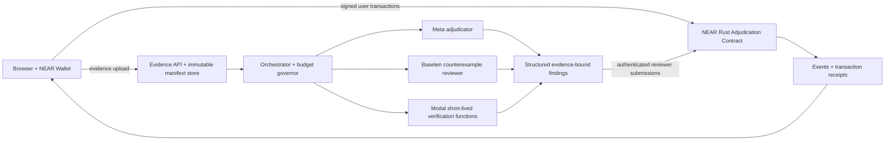

# CONTRA architecture boundaries

## Components



## Contract boundary

- Hold escrow and immutable terms.
- Control rounds, committee membership, deadlines and vote commitments.
- Record evidence digests, not raw personal documents.
- Enforce deterministic payout recipient and amount.
- Never call hosted LLM APIs from the contract.

## Service boundary

- Gateway abstracts provider details, retries, response schema, signing requests and model version.
- Evidence store keeps SHA-256 content digests, URI references, retrieval timestamps, provenance and access controls.
- Verification worker runs bounded and sandboxed scripts. Never run arbitrary user-supplied code without isolation and resource limits.
- Workers may propose and sign judgments, but cannot instruct the contract to ignore policy.

## Budget governor

- Meta allocation: $3, Baseten: $3, Modal: $5, initial ceiling.
- Total credit pools user-reported: $10 + $10 + $30 monthly.
- Persist reservations and usage before requests, reconcile to provider invoices and provider-side spend caps.
- Allowlist models, max token counts, max runtime, max concurrency, one retry and fixed timeouts.
- Cache replay fixtures. Pre-recorded demos must be labelled recorded.
- Credit exhaustion: skip live inference; show explicit unavailable state. No automatic spending beyond authorization.
- Verify actual billing terms, credit eligibility and expiration before a paid call; software cost caps are not substitutes for a provider-side hard limit.

## Security model

Onchain security is limited to deterministic rules and NEAR execution. Reviewer registry v1 is permissioned and is not automatically decentralized just because accounts differ. Offchain attestations, if used, prove only narrowly defined environment properties. Source provenance and human-readable model explanations remain subject to manipulation and error.

## Proposed repo layout after November 1

```text
contra/
  contracts/adjudication/
  apps/web/
  services/evaluator-gateway/
  services/evidence/
  packages/protocol-types/
  tests/sandbox/
  tests/adversarial/
  benchmarks/
  docs/
  design/
  project/
  AGENTS.md
  README.md
```

Cloudflare Pages or an equivalent static edge frontend serves UI. Dynamic evaluator workloads run on bounded functions; no always-on GPU or inference instance is required.
