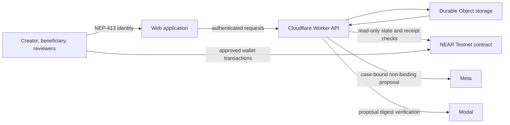

# CONTRA architecture and trust boundaries

CONTRA separates advisory analysis, human judgement and deterministic financial authority.

## Onchain authority

The Rust NEAR contract freezes criteria and timing, validates reviewer committees and votes, controls challenge transitions, determines settlement under the quorum and fallback rules, and verifies the payout callback. Native NEAR is the v1 escrow asset.

The contract accepts neither model responses nor API state as financial authority. Its ABI, state machine, committee rules and settlement recovery are specified in [the protocol documents](PROTOCOL.md).

## Browser identity and transaction boundaries

The frontend authenticates an account with a server-verified NEP-413 signature. It displays eligible actions but cannot become a signer or authorise transactions on behalf of an account. Case creation and other financial operations must be prepared against the frozen request, confirmed by the correct wallet and restricted by an exact, server-authorised operation.

The currently allowlisted creator is `contra-creator.testnet`. Browser control of its verified key was not demonstrated at the backend completion checkpoint. Never import private material into frontend code.

## Durable service

The Cloudflare Worker and SQLite-backed Durable Object store account-scoped sessions, reviewer invitations, signed control statements, disclosures, evidence manifests, provider jobs and budget reservations, operation intents and audit records. Authorised reads are bound to the current account and case. Successful API storage does not prove onchain submission or finality.

Provider records are protected independently of the generic evidence-artifact endpoint. UNKNOWN payout operations cannot be redispatched automatically.

## Reviewer independence

The primary and appeal committees each require three eligible, confirmed reviewers and must be disjoint. Signed operator-control statements, conflict checks and contract registration support independence verification but fixtures controlled by one process cannot demonstrate six real independent humans.

## Bounded AI

Meta supplies optional case-bound evaluation proposals. Modal verifies an exact proposal digest, evidence citations, terms and round identity. Both are non-binding, use separate authenticated runtime and billing gates, and can remain disabled even when the backend reports healthy.

Baseten is retired from the active provider set. Retained earlier records are historical, not an active runtime configuration.

## Operational state

The backend and Testnet contract were deployed and verified at the 12 November 2026 backend checkpoint. Production signing and live provider case-bound inference were gated. The approved branded dashboard remained on draft PR #95 rather than the deployed `main`.

Release acceptance and remaining actions are defined in [the three-phase completion plan](COMPLETION_PLAN.md), with detailed operational runbooks under [operations](operations/CLOUDFLARE_DEPLOYMENT.md) and [reproducibility](testing/REPRODUCIBILITY.md).
