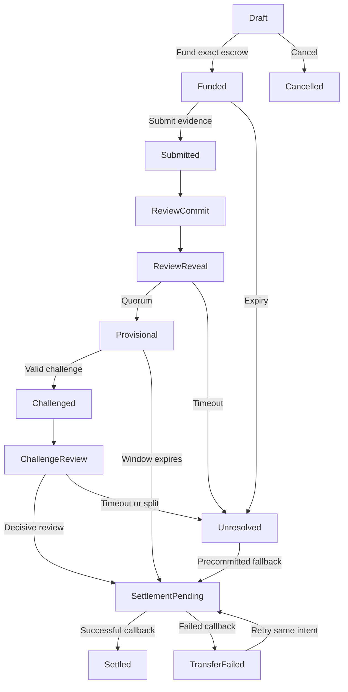

# CONTRA protocol and settlement state machine

## UX3C authoritative freeze notice | 2026-10-28

The conceptual specification below is preserved as history. The v1 implementation authority is docs/CONTRACT_ABI_V1.md, docs/STATE_MACHINE_V1.md, docs/COMMITTEE_POLICY_V1.md, docs/SETTLEMENT_RECOVERY_V1.md, docs/COMMITMENT_TEST_VECTORS.md and docs/THREAT_MODEL_V1.md. UX3C resolves G01-G07 under the owner's protocol-freeze instruction. In particular, creator-only cancel_case and beneficiary accept_terms are explicit; committees are frozen six distinct declared operators (3+3); fresh inconclusive review retains the primary decisive verdict instead of the old automatic creator-refund interpretation; RefundPending is removed; unknown payout outcomes are not recoverable in MVP. I7/I10 liveness is explicitly qualified in STATE_MACHINE_V1 and THREAT_MODEL_V1; I2 is never bypassed. No documentation check is a smart contract test.

Status: Design proposal, not deployed or security audited

## Trust boundary

NEAR contracts enforce account authentication, case terms, deadlines, committee membership, vote commitments, deterministic quorum, challenge lockouts and transfers. AI inference, retrieval and interpretation happen offchain. The contract cannot prove an AI verdict is factually true just from a signed message or a majority vote.

## Actors

- Creator: deposits escrow, freezes criteria and selects fallback policy.
- Beneficiary: performs work and submits deliverables.
- Reviewer: authorized account for a specific adjudication round. No reviewer can vote twice for a round.
- Challenger: authorized creator or beneficiary, submits evidence-backed challenge before deadline.
- Keeper: permissionless caller that advances timed transitions. No special settlement privilege.
- Contract: sole source of monetary state and adjudication deadlines.

## Main states

| State | Entered by | Allowed actions | Exit |
| --- | --- | --- | --- |
| Draft | `create_case` | Inspect terms; cancel before funding | Funded or Cancelled |
| Funded | `fund_case` with exact deposit | Submit deliverable; expire per agreed policy | Submitted or RefundPending |
| Submitted | `submit_evidence` | Seal evidence manifest, assign round | ReviewCommit |
| ReviewCommit | Round opening | Eligible reviewers commit hash before deadline | ReviewReveal |
| ReviewReveal | Deadline / round advance | Reveal bound vote with nonce and evidence hash | Provisional or Unresolved |
| Provisional | Quorum result | Challenger files one valid challenge; wait for clock | Challenged or SettlementPending |
| Challenged | Eligible party attaches challenge manifest | Enroll disjoint review set and start fresh round | ChallengeReview |
| ChallengeReview | Fresh round starts | Commit-reveal, independent review and timeout | SettlementPending or Unresolved |
| Unresolved | No valid decisive vote | Apply immutable fallback policy | SettlementPending |
| SettlementPending | Final decision plus dispatch of transfer | Wait for callback; do not initiate another transfer | Settled or TransferFailed |
| TransferFailed | Verified failed callback | Keeper retries same payout intent; fixed receiver and amount | SettlementPending |
| Settled | Verified success callback | Read only | Terminal |
| Cancelled | Authorized cancellation before funding | Read only | Terminal |

## Settlement decision policy for v1

Frozen when funded:
- `accepted`: pay beneficiary.
- `rejected`: refund creator.
- `unresolved`: refund creator after maximum review deadline.
- Review deadline and challenge deadline are absolute, bounded timestamps.
- No settlement occurs while a valid challenge remains in review.

Consequence: A buyer-favored unresolved default is a contract choice for the prototype, not a universal fairness rule. Both parties see and accept it before escrow funding.

## Reviewer quorum

Pilot: 3 registered reviewer accounts per round, threshold 2 matching valid reveals on the same disposition. Vote choices: ACCEPT, REJECT, UNRESOLVED. If quorum is absent by deadline, resolve UNRESOLVED. A challenged round should use a disjoint committee when enough independent participants exist; if not, display this risk and avoid claims of independence.

Commit hash specification should be deterministic and language-agnostic. Proposed preimage fields, in exact serialization order:

`CONTRA:v1 | chain_id | contract_account | case_id | round_id | reviewer_account | disposition | evidence_digest | random_nonce`

Implement canonical byte serialization, length prefixing or strict Borsh, and strong hashing. Signatures / NEAR account authentication must be checked onchain. Prevent replay across chain, contract, case and round. Do not log the reveal nonce before revealing.

## Core contract methods (conceptual interfaces)

- `create_case(params)`
- `fund_case(case_id)` payable
- `submit_evidence(case_id, manifest_digest)`
- `commit_vote(case_id, round_id, commitment)`
- `reveal_vote(case_id, round_id, disposition, evidence_digest, nonce)`
- `advance_round(case_id)`
- `file_challenge(case_id, counterexample_digest)`
- `finalize_case(case_id)`
- `retry_payout(case_id)`
- `on_payout_complete(case_id, payout_intent_id)` private callback
- Read-only: `get_case`, `get_round`, `get_events`, `get_committee`

Parameter and account validation, serialization, deposit policy and NEAR promise APIs remain implementation work.

## Non-negotiable invariants

I1. Escrow amount is covered by actual deposited funds and never exceeds contract-held available balance reserved for that case.
I2. For one escrow case, at most one final payout may complete; all transfer attempts reference a single immutable payout intent.
I3. Terms, eligible parties, acceptance criteria and unresolved fallback are immutable after funding.
I4. No actor can directly change `Provisional` to `Settled` without passing challenge deadlines and settlement callback.
I5. A vote is bound to one reviewer, one case and one round, with no duplicate reveal.
I6. A challenged decision cannot release escrow before challenge resolution or timeout.
I7. Invalid external evidence, missing evidence or reviewer timeouts lead to bounded unresolved policy, never unbounded locked funds.
I8. Contract never equates model confidence or majority agreement with established truth.
I9. Untrusted evidence contents cannot inject contract actions or backend secrets.
I10. Callback checks the intended contract origin, payout intent and exact result; a failed or delayed transfer remains recoverable.

## Important NEAR engineering consideration

Cross-contract transfers are asynchronous. Transition to `SettlementPending` when the transfer is issued. Transition to `Settled` only after a verified successful callback. On failure, retry the same immutable payout target and amount under an idempotent payout intent. The agent must test callbacks, failed transfers and concurrent attempts in sandbox before testnet funds are deposited.

## Lifecycle diagram

## Deferred to post-hackathon

Permissionless juror selection, onchain dispute bonds, penalties/slashing, full economic security, multi-level appeals, confidential evidence verification, and cross-chain assets.
